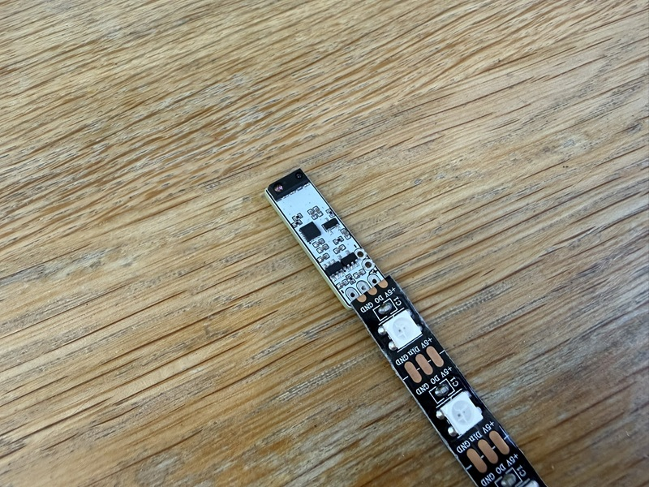
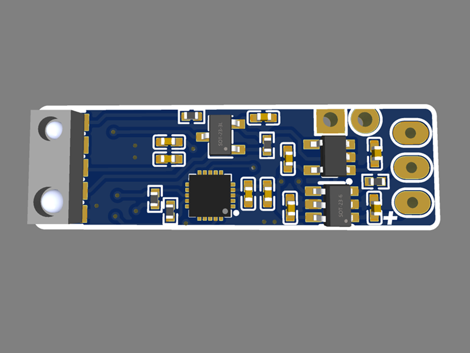
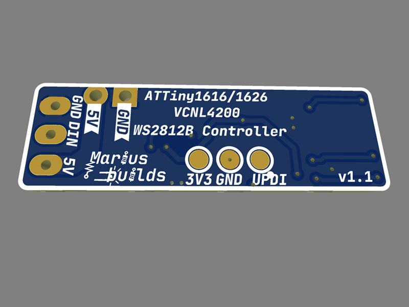
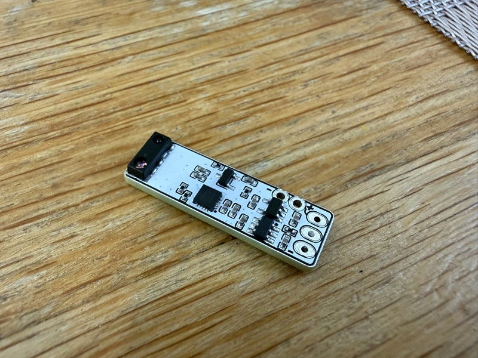
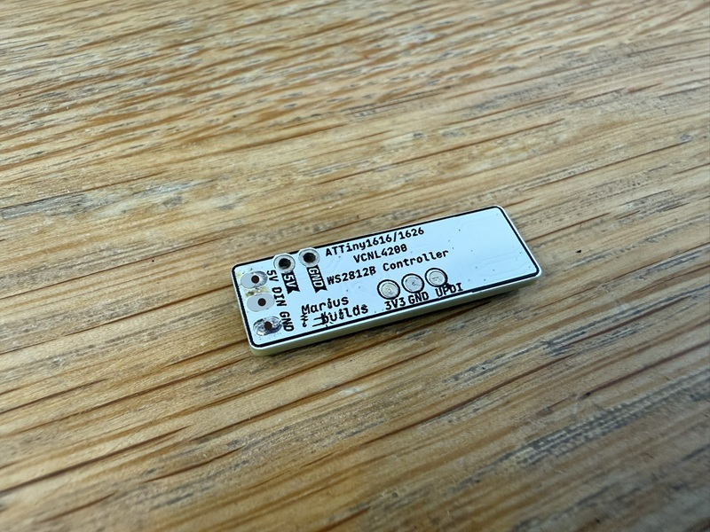

# WaveLight MINI : ATtiny1626 + VCNL4200 WS2812B LED Controller

The little brother of [WaveLight](https://github.com/mariusmym/WaveLight-ATtiny1614-VCNL4200-Controller), shrunk down to **9.5mm wide** – exactly the width of an LED strip. The pads line up with the strip's own solder pads, so you solder the controller **straight onto the start of the strip** (I repaired this in v1.1 - pics in this repo are with v1.0. The Gerber files of the repo are v1.1, so is all good). No wires, no connectors, no hiding place needed. 
It just looks like the strip grew a brain 😎.

Wave your hand (or walk by), the lights come on. Walk away, they go off.

  

## How it works ?

The brain is an **ATtiny1626** (QFN-20, 3x3mm), talking to a **VCNL4200** sensor that combines two senses in one tiny package:

- **Ambient light sensor (ALS)** – measures how bright the room is, so the lights don't turn on in broad daylight like a confused streetlamp.
- **Proximity sensor** – detects objects or movement within range, using its own IR LED.

The ATtiny reads both values in real time and decides when the WS2812B strip should be ON or OFF. Perfect for wardrobes, drawers, stairs, under-cabinet lighting, or any place where you're tired of looking for the light switch in the dark – and now also for places where even the big WaveLight was too big.

## MAIN FEATURES :

- **9.5mm wide** – the same width as the LED strip, so it disappears into an aluminium profile together with the strip.
- **Solders directly onto the strip** – the 5V / DIN / GND pads match the strip's pads.
- **ATtiny1626** (QFN-20) – same UPDI programming as the big version, in a fraction of the space. The **ATtiny1616** fits the same footprint too.
- **VCNL4200** ambient light + proximity sensor – two sensors for the price of one footprint.
- **SN74LVC1T45 level shifter** – turns the 3.3V data signal into a proper 5V one, so the WS2812B strip actually listens instead of just nodding politely.
- **AP2112K 3.3V LDO** – powers the logic and the sensor from the 5V supply.
- **P-MOSFET (SI2301)** on board for power switching.
- **0402 passives** – because 0603 was apparently too comfortable.

  
  

## Pinout 

| Pads | Function |
|---|---|
| **5V / DIN / GND** (end of the board) | Solder directly to the start of the WS2812B strip |
| **5V / GND** (back) | Power input (5V) |
| **3V3 / GND / UPDI** (back) | Programming pads for a UPDI programmer |

## IMPORTANT INFORMATIONS ! 

1. **A stencil is pretty much mandatory.** The ATtiny1626 is a QFN with 0.4mm pitch pins and a thermal pad underneath, and all the passives are 0402. Hand-soldering it with an iron is somewhere between "extremely hard" and "a story you'll tell at parties". Use a **stencil, solder paste and a hot plate** (or hot air) – or let the PCB fab assemble it for you.

2. **You need a UPDI programmer to upload the sketch.** The ATtiny1626 doesn't do USB, it only speaks UPDI. Any SerialUPDI programmer works, including [this one](https://github.com/mariusmym/Serial-UPDI-Programmer-USB-C-) 😎.

3. **Use the 3V3 / GND / UPDI pads for programming.** Match the voltage on your programmer to the 3V3 pad, otherwise the board will get more voltage than it asked for. Program it **before** you solder it to the strip – it's a lot easier to reach the pads that way.

4. **Mind the direction.** The controller's **DIN** has to land on the strip's **DIN**, at the *start* of the strip (follow the little arrows on the strip). Solder it to the DO end and the strip will politely ignore you.

5. **Size your power supply for the LED strip.** WS2812B LEDs can draw up to ~60mA each at full white, so the strip, not the ATtiny, decides how big your power supply needs to be.

  
  

## The example sketch 

The sketch in the **SKETCH** folder turns the board into a hands-free night light with a "touch" override:

- **Automatic mode** – when it's dark **and** something comes within range, the strip turns on (warm-ish white, nothing fancy) and switches itself off after **1 minute**. Like a fridge light, but for your hallway.
- **Touch override** – while the LEDs are on, bring your hand really close to the sensor (a few mm) and they turn off immediately. The board then enters **manual mode for 1 minute**: every close "touch" toggles the strip ON/OFF, and the automatic sensing is ignored. Perfect for when you want to walk past without the lights following you around like a puppy.
- After the minute is over, it goes back to automatic mode on its own.

### Settings you can tweak

All the "knobs" are at the top of the sketch:

| Setting | Default | What it does |
|---|---|---|
| `NUMLEDS` | 44 | Number of LEDs in your strip |
| `LED_PIN` | `PIN_PA7` | Data pin for the strip  |
| `PROXIMITY_THRESHOLD` | 30 | How close you need to be. Higher = closer (≈180 at 30cm, ≈40 at 60cm, ≈12 at 100cm) |
| `TOUCH_THRESHOLD` | 1000 | Value for a "touch" (a few mm from the sensor) |
| `AMBIENT_LIGHT_THRESHOLD` | 2 | How dark it must be. With the ceiling lights on it's 11000+, TV-only ≈13, minimum is 2 |
| `OVERRIDE_DURATION` | 60000 | Manual mode length, in ms |
| `timeoutDuration` | 60000 | How long the LEDs stay on in automatic mode, in ms |
| `brightness` | 100 | LED brightness (0–255) |

Pro tip: if your LEDs turn on while the room is still bright enough to read a book, raise `AMBIENT_LIGHT_THRESHOLD`. If they ignore you from across the room, raise... no wait, *lower* `PROXIMITY_THRESHOLD`. Proximity values go up as you get closer, because physics.

## Programming 

1. Install [megaTinyCore](https://github.com/SpenceKonde/megaTinyCore) by SpenceKonde in Arduino IDE. It already includes the `tinyNeoPixel_Static` library used by the sketch.
2. Install a VCNL4200 library that provides `Vishay_VCNL4200.h`.
3. Under **Tools → Board**, select the megaTinyCore entry that lists the **ATtiny1626** (or 1616, if that's what you used), then pick it under **Tools → Chip**.
4. Under **Tools → Programmer** choose a **SerialUPDI** option (230400 baud is a good start).
5. Connect the programmer to the **3V3 / GND / UPDI** pads, open the sketch from the **SKETCH** folder, set `NUMLEDS` for your strip, and use **Upload Using Programmer** (Ctrl+Shift+U).

## Main components 

| Part | Component | LCSC |
|---|---|---|
| MCU | ATTINY1626-MU (QFN-20) | C5227676 |
| Light & proximity sensor | VCNL4200 | C510773 |
| Level shifter | SN74LVC1T45DBVR | C7843 |
| LDO 3.3V | AP2112K-3.3TRG1 | C51118 |
| P-MOSFET | SI2301BDS-T1-GE3 | C558242 |

Full BOM in the **GERBER, BOM, PNP** folder.

## Repository content 

- **GERBER, BOM, PNP** – Gerbers, BOM and pick-and-place files.
- **SCHEMATIC** – the schematic.
- **SKETCH** – the example Arduino sketch (automatic mode + touch override).
- **Images** – renders and photos.

## Need the bigger version?

If 0402 parts and a QFN sound like a nightmare, the original [WaveLight](https://github.com/mariusmym/WaveLight-ATtiny1614-VCNL4200-Controller) uses an SOIC-14 ATtiny1614 and 0603 parts, and comes in three sensor orientations. Same features, friendlier to soldering irons.

## If you want to edit the PCB
 
**Project can also be found here:** [https://oshwlab.com/mariusmym/attiny1616_vcnl4200_rgb_controller](https://oshwlab.com/mariusmym/attiny1616_vcnl4200_rgb_controller)

## License 

This project is licensed under [Creative Commons Attribution-ShareAlike 4.0 International](https://creativecommons.org/licenses/by-sa/4.0/).

- ✅ **Share** – copy and redistribute it in any medium or format
- ✅ **Adapt** – remix, transform, and build upon it
- 🏷️ **Attribution** – give credit and link back here
- 🔁 **ShareAlike** – if you remix it, share your version under the same license

## Donate ☕

If you'd like to say thanks or buy me a coffee, a **[PayPal donation](https://www.paypal.com/donate/?hosted_button_id=KHR7DYJP2Z8QJ)** is always appreciated!

Have fun and enjoy it ! 😊
